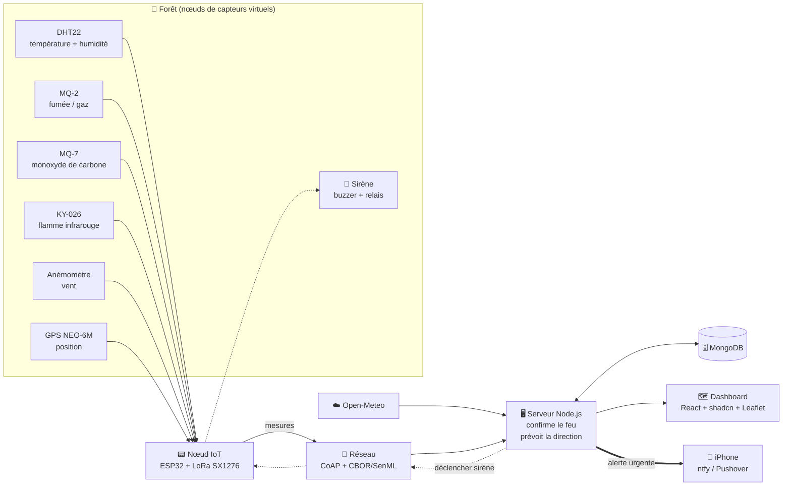

# Architecture FireWatch

## Flux d'une mesure

1. Le nœud lit ses capteurs et construit un paquet **SenML**.
2. Le paquet est codé en **CBOR** et envoyé en **CoAP POST** (UDP 5683).
3. Le serveur décode, enregistre dans **MongoDB** et met à jour la carte via **Socket.io**.
4. La réponse CoAP transporte les ordres vers le nœud (fréquence d'envoi, sirène).
